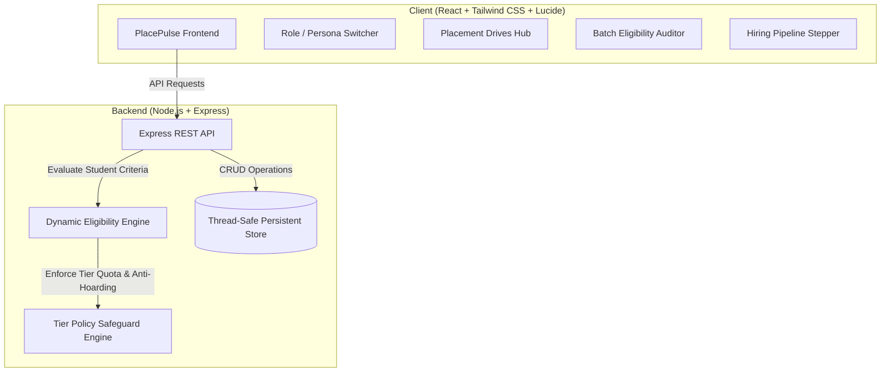

# 🎓 PlacePulse - Centralized Campus Placement & Automated Eligibility Verification Platform

> **Solving Student Misplacement, Rule Violations, and Scattered Information in University Hiring Drives.**

[](https://nodejs.org/)
[](https://react.dev/)
[](https://tailwindcss.com/)
[](LICENSE)

---

## 📌 The Problem Statement

In colleges and universities across the globe, campus recruitment management suffers from two critical, recurring bottlenecks:

1. **Scattered Information Channels (WhatsApp & Email Chaos)**:
   - Placement notices, PDFs, criteria updates, and deadline reminders are scattered across dozens of unorganized WhatsApp groups, forwarded email chains, and notice boards.
   - **Consequences**: Important application deadlines get lost under casual chat and memes. Truly eligible students miss out on top companies simply because they didn't see a message in time.

2. **Student Misplacement & Eligibility Policy Violations**:
   - **Ineligible Submissions**: Students submit Google Forms without meeting multi-variable criteria (e.g. CGPA, active backlogs, history backlogs, allowed branch, 10th/12th percentages).
   - **Administrative Overhead**: TPOs spend hundreds of hours manually auditing Excel sheets with 500+ student rows, leading to errors, company disqualifications, or blacklisting threats.
   - **Offer Hoarding (Double Placement)**: A student who secures an offer in a Dream company (e.g. 7 LPA) continues applying to other 6–8 LPA drives, stealing opportunities from unplaced peers and skewing university placement rates.

---

## 💡 The PlacePulse Solution

**PlacePulse** is a full-stack, enterprise-grade placement management platform engineered with an **Automated Dynamic Eligibility Engine** and a **Centralized Drive Hub**.

### 🌟 Core Capabilities

- ⚡ **Centralized Placement Hub (Anti-WhatsApp Architecture)**:
  - Structured company drive cards with real-time countdown timers to deadlines.
  - Transparent CTC breakdown (Base, Variable, Stocks) and multi-round hiring schedules.
  - Direct attachments (JDs, syllabus, brochures) with zero external messaging dependencies.

- 🛡️ **Automated Dynamic Eligibility Verification Engine**:
  - Automatically evaluates logged-in students against 8+ academic and policy variables:
    - Minimum CGPA cutoff
    - Maximum active backlogs permitted (0, 1, 2)
    - Historical / cleared backlog restrictions
    - Allowed branches / departments (CSE, IT, ECE, Mech, etc.)
    - Class 10th & 12th / Diploma percentage cutoffs
    - Diversity criteria (e.g. Women in Tech programs)
  - Color-coded itemized checklist for students: Green (*PASS*) and Red (*FAIL*) with exact rationale.
  - Blocks ineligible submissions at the API and UI level.

- 🔒 **Institutional Placement Policy Safeguards (Anti-Hoarding Engine)**:
  - **Tier 1 (Super Dream > 12 LPA)**: Upon receiving an offer, the student is automatically locked from future drives to prevent offer hoarding.
  - **Tier 2 (Dream 6–12 LPA)**: Students holding a Dream offer can only apply for Super Dream drives where the new CTC is at least 1.4x of their current offer.
  - **Tier 3 (Regular < 6 LPA)**: Students with mass recruiter offers can upgrade freely to Dream or Super Dream tiers.
  - **Unplaced Students**: Priority clearance for all eligible drives.

- 📊 **TPO Batch Eligibility Auditor**:
  - In one click, TPOs can audit the entire student body against any drive's criteria.
  - Instantly reveals: `Total Batch` → `Total Eligible` → `Registered` → **`Eligible but Unapplied Candidates`**.
  - **Targeted Broadcast Reminder**: One-click broadcast sent directly to the unapplied eligible students so no candidate is left behind.

- 📈 **Pipeline Progression & Analytics Dashboard**:
  - Stepper tracking from `Applied` → `OA Cleared` → `Technical Round` → `HR Round` → `Offered`.
  - One-click CSV export formatted for HR company submission.
  - Institutional analytics: Placement rate %, average CTC, highest package, department breakdown, and misplacement violations prevented.

---

## 🏗️ System Architecture



---

## 🛠️ Tech Stack

- **Frontend**:
  - React 18 (Hooks, modern component architecture)
  - Vite 6 (Lightning-fast build tool)
  - Tailwind CSS 3.4 (Custom dark-slate UI, responsive layout)
  - Lucide React (Crisp modern iconography)
- **Backend**:
  - Node.js & Express 4
  - Custom Rule & Eligibility Engine
  - CORS, Dotenv
- **Database & Storage**:
  - Persistent JSON database with atomic file transactions (zero external DB installation required)
  - Pre-seeded with realistic students, companies (Google, Cisco, Deloitte, L&T, Adobe, TCS), and policies
- **DevOps & Tooling**:
  - Git repository structure
  - Single-command unified development and production servers

---

## 🚀 Getting Started

### Prerequisites

- [Node.js](https://nodejs.org/) (v18, v20, v22, or v24)
- Git

### 1. Installation

Clone or open the project directory and install dependencies:

```bash
# Install server dependencies
cd server
npm install

# Install client dependencies
cd ../client
npm install
```

### 2. Seed the Database

Populate realistic student records, company drives, announcements, and policy rules:

```bash
cd server
npm run seed
```

### 3. Run the Application

#### Option A: Unified Full-Stack Server (Recommended)
Build the frontend and run both API and client on port `5000`:

```bash
# From client/ directory:
npm run build

# From server/ directory:
npm start
```

Open your browser at: **`http://localhost:5000`**

#### Option B: Hot-Reloading Development Mode
Run frontend and backend concurrently:

```bash
# Terminal 1 (Backend API on :5000)
cd server
npm run dev

# Terminal 2 (Vite Frontend on :5173 with proxy to :5000)
cd client
npm run dev
```

---

## 👥 Interactive Demo Personas

Use the **"Switch Persona"** dropdown in the top navigation to test all eligibility conditions and role permissions:

| Persona | Role / Department | Academic Standing | Eligibility Behavior |
| :--- | :--- | :--- | :--- |
| **Dr. Rajesh Sharma** | Head TPO Admin | Placement Cell Head | Full admin rights: Post drives, audit batches, advance candidate stages, view analytics |
| **Aarav Sharma** | CSE (2026 Batch) | CGPA 8.85, 0 Backlogs, Unplaced | **Eligible** for Google (Super Dream), Cisco, Deloitte |
| **Priya Patel** | ECE (2026 Batch) | CGPA 7.42, Placed at TCS Digital (7 LPA) | **Policy Safeguard**: Blocked from Tier 2 & Tier 3; can only upgrade to Super Dream (>12 LPA) |
| **Rohan Verma** | CSE (2026 Batch) | CGPA 6.45, 2 Active Backlogs | **Blocked by Cutoffs**: Ineligible for Google & Cisco (requires CGPA &ge; 7.0 and 0 backlogs) |
| **Sneha Kulkarni** | Mechanical Engg | CGPA 8.20, 0 Backlogs | **Branch Filtered**: Eligible for Core R&D (L&T Technology), blocked for pure CS roles |
| **Vikram Malhotra** | IT (2026 Batch) | CGPA 9.35, Placed at Microsoft (44 LPA) | **Policy Locked**: Quota completed; locked from applying to ensure fair batch distribution |

---

## 📡 API Reference

### Placement Drives
- `GET /api/drives` - List all placement drives
- `GET /api/drives/:id` - Get drive details
- `POST /api/drives` - Create new drive with eligibility rules (TPO Admin)
- `GET /api/drives/:id/eligibility-audit` - Batch audit whole student body against this drive

### Students & Eligibility
- `GET /api/students` - List all students
- `GET /api/students/:id/eligible-drives` - Real-time evaluated drives with pass/fail checklists
- `GET /api/students/:id/applications` - Student application history
- `PUT /api/students/:id` - Update profile, skills, and resume link

### Applications & Safeguards
- `GET /api/applications` - List applications (supports `driveId`, `studentId`, `status` filters)
- `POST /api/applications` - Submit application (runs backend eligibility engine; rejects if criteria violated)
- `PATCH /api/applications/:id/status` - Advance applicant stage (`APPLIED` → `OFFERED`)
- `GET /api/applications/export/csv/:driveId` - Export formatted CSV for corporate submission

### Intelligence & Broadcasts
- `GET /api/analytics` - Institutional placement statistics, average CTC, and safeguard metrics
- `GET /api/announcements` - Official broadcasts replacing WhatsApp
- `POST /api/announcements` - Publish high-priority announcement
- `GET /api/audit-logs` - Security ledger of blocked attempts and policy locks

---

## 🤝 Pushing to Your GitHub Repository

When ready, add your GitHub repository remote and push:

```bash
git remote add origin https://github.com/<YOUR_GITHUB_ID>/<YOUR_REPO_NAME>.git
git branch -M main
git push -u origin main
```

---

## 📄 License

This project is licensed under the MIT License - see the [LICENSE](LICENSE) file for details.
